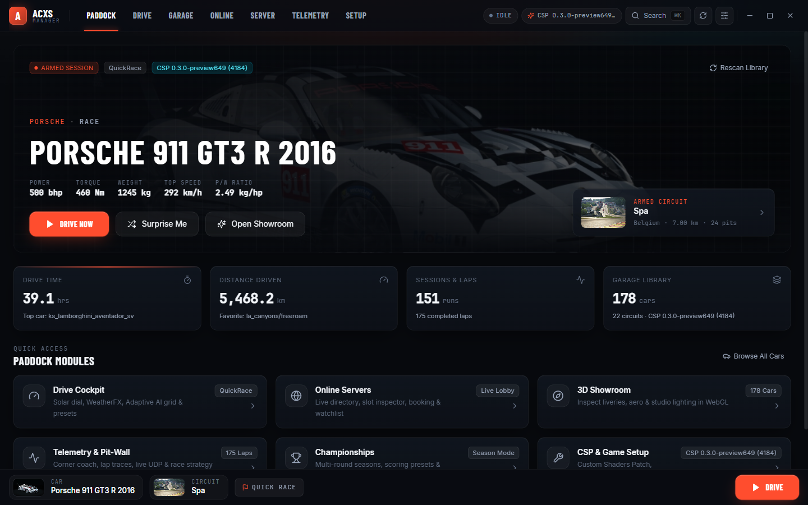
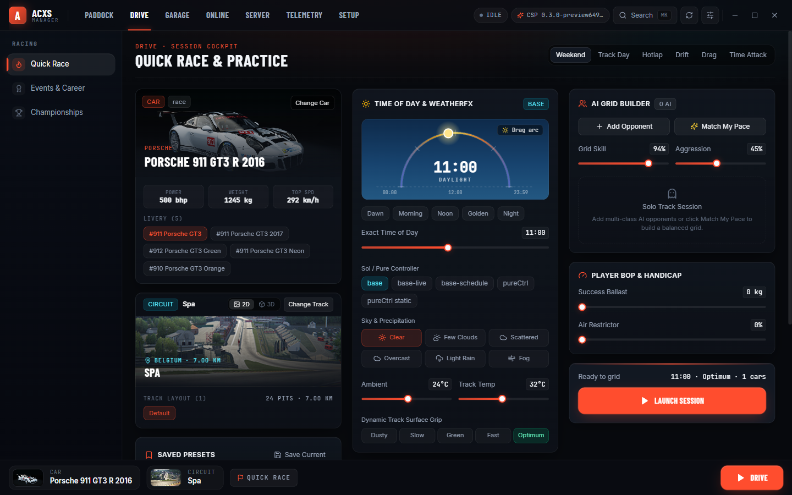
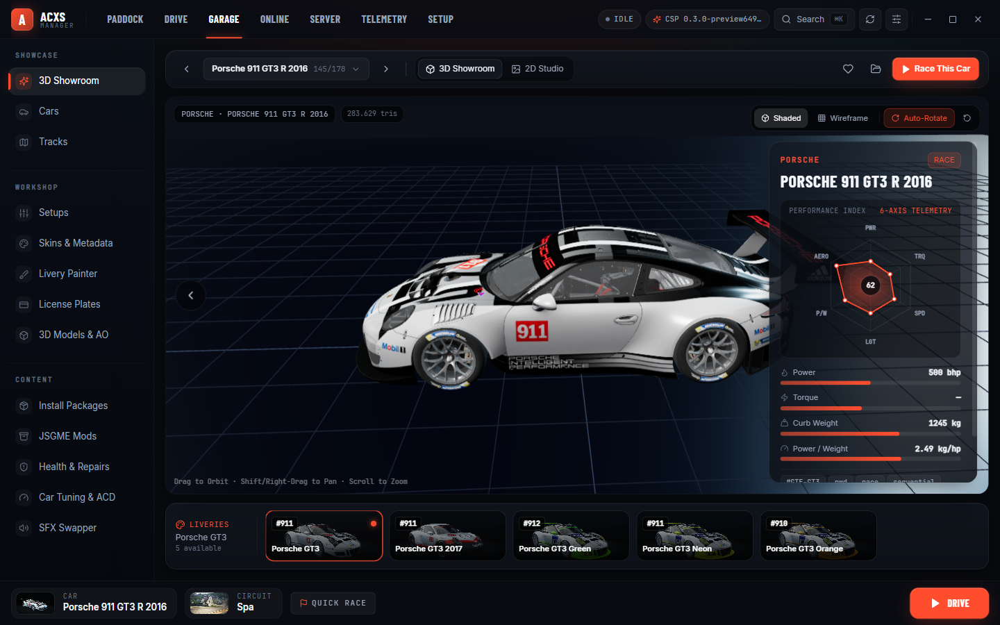
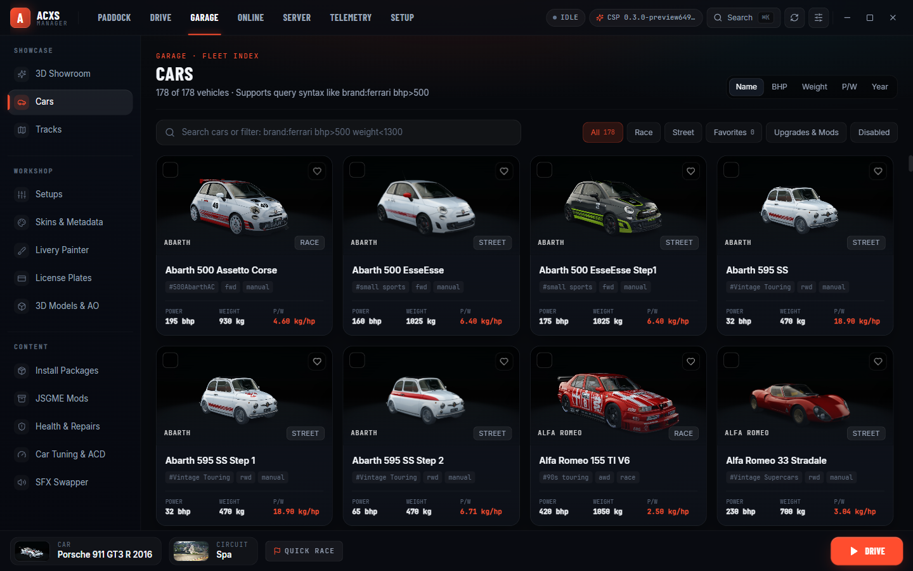
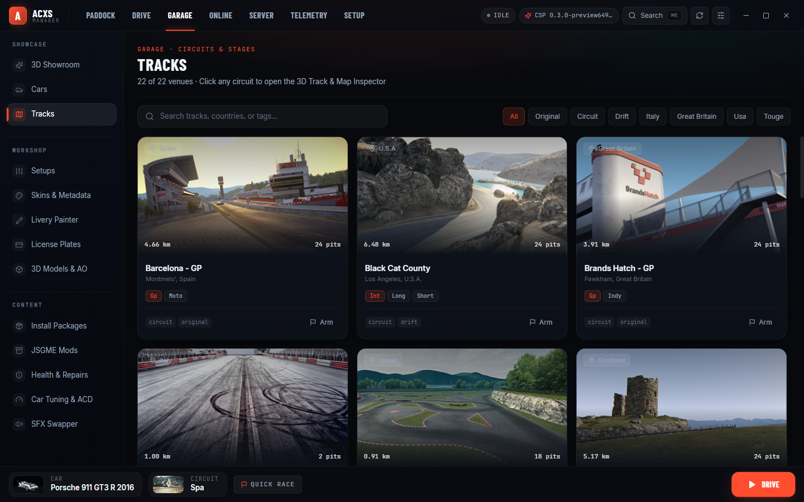
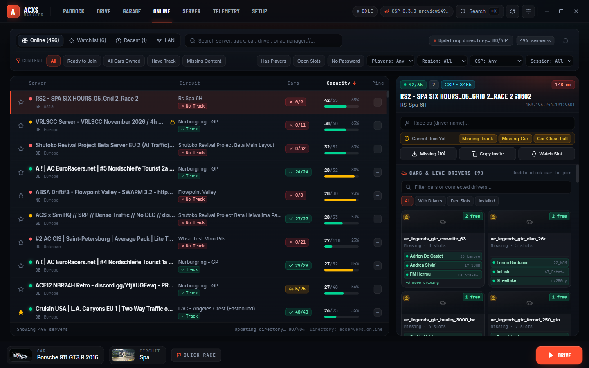
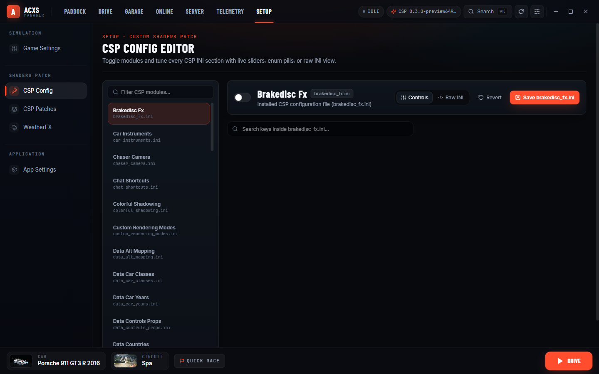
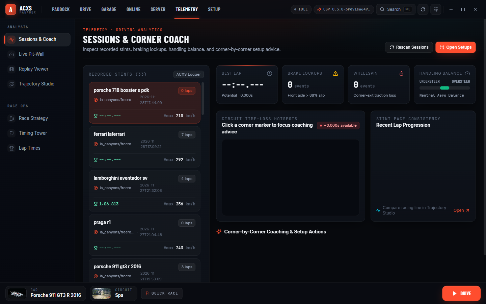

# ACXS Manager (v0.4.0)

ACXS Manager is a native desktop manager for **Assetto Corsa** built on a pure-Rust core library (`acxs_manager`, 118 modules, 1,221 unit tests) paired with a **Tauri v2 + React 19 + TypeScript + Tailwind CSS v4 + Three.js** desktop UI (`src-tauri/` + `ui/`). It brings content management, racing & online server joining, dedicated server hosting/RCON, CSP & VR/Controls configuration, standalone 3D Showroom/Replay/Track/Trajectory tools, and live telemetry into one fast frameless dark-glass window — without needing Content Manager.

*(The legacy `egui`/`eframe` binary remains buildable from the root crate; the primary v0.4.0 desktop app is `src-tauri/` + `ui/`.)*

## A Look at v0.4.0

| | |
|---|---|
|  |  |
| **Paddock**: featured car, quick launch, and content & driving stats at a glance | **Drive**: Quick Race & Practice with 2D/3D rotating track corridor preview, layout selector, and AI grid |
|  |  |
| **3D Showroom**: KN5 renderer with `ksPerPixelMultiMap` paint compositing, skin switcher, and 6-axis radar | **Cars**: searchable card grid with previews, skins, favorites, and class/tag filters |
|  |  |
| **Tracks**: layout previews, surface details, and track maps | **Online**: live server browser with track/car ownership badges, multi-filter bar, and driver inspector |
|  |  |
| **CSP Config**: searchable INI sections, modified-value indicators, and one-click save | **Telemetry & Corner Coach**: lap telemetry, delta traces, and corner-by-corner driving analysis |

Press `Ctrl+K` anywhere to jump to a page, tool, car, or track. Drop a car or track `.zip` onto the window to install it. Quick Race and online server joining launch Assetto Corsa directly; Content Manager is not required.

## Feature Overview

- **Frameless Dark-Glass Desktop Shell:** Custom Minimize / Maximize / Close window controls, themed right-click context menus, command palette (`Ctrl+K`), and drag-and-drop `.zip` mod installation.
- **Drive:** Quick Race & Practice with 2D/3D rotating track corridor preview, direct layout selector, searchable Car/Track pickers, weather/time-of-day presets, driver aids, and AI grid builder.
- **Garage:**
  - **3D KN5 Showroom:** Real-time Three.js KN5 viewer with `ksPerPixelMultiMap` car-paint compositing, Car Chooser, skin switcher, and 6-axis telemetry radar.
  - **Cars & Tracks:** Fast scanning, filtering, favorites, collections, metadata editing, content health checks & repairs, car/track comparison, and CSV/JSON export.
  - **Setups, Livery Painter & Car Tuning:** Setup browser/editor/3-way merge, skin recolouring & licence plates, and engine/mass/fuel/gearing tuning.
- **Online:** Live server browser with immediate track & car ownership badges, multi-filter bar, watchlist, and live driver/car inspector.
- **Server, Telemetry & Setup:**
  - **Dedicated Server Manager:** Edit server config & entry lists, start/stop server processes, RCON, and live server status.
  - **Lap Telemetry & Corner Coach:** Live UDP telemetry & Windows shared memory reader, lap delta traces, track map trouble spots, setup suggestions, and CSV export.
  - **Game Settings & CSP:** Display, VR/Triple-screen, Force Feedback (FFB), CSP Lights Patch installer/switcher (with rollback), CSP Config Editor, and WeatherFX.

The full feature coverage matrix is in [ROADMAP.md](ROADMAP.md).

## Architecture

```
acsx-manager/
  src-tauri/            Tauri v2 Rust backend, IPC commands, window & native integrations
  ui/                   React 19 + TypeScript + Tailwind CSS v4 + Three.js frontend
  src/                  Pure-Rust core library (`acxs_manager`: 118 modules) + legacy eframe binary
  scripts/              Release packaging & Windows cross-compile helpers
  docs/                 Architecture notes & v0.4.0 screenshots
  BUILD.md              Detailed build instructions for Windows & macOS
  ROADMAP.md            Feature coverage matrix
```

## Building & Running

### Prerequisites

- **Rust** (stable toolchain via `rustup`)
- **Node.js** (LTS) & **npm**
- **Tauri v2 system dependencies** (WebView2 on Windows; Xcode Command Line Tools on macOS)

### Build Tauri v2 Desktop App (Release)

```sh
cd ui && npm install && npm run build
cd ../src-tauri && cargo build --release --features tauri/custom-protocol
```

Output binary: `src-tauri/target/release/acxs-tauri.exe` (Windows) or `src-tauri/target/release/acxs-tauri` (macOS/Linux). You can also run `npx tauri build` from `ui/`/`src-tauri/` to bundle a Windows NSIS/MSI installer.

### Dev Mode

```sh
npm --prefix ui run dev -- --port 1420 --strictPort
cargo run --manifest-path src-tauri/Cargo.toml
```

### Core Library Tests

```sh
cargo test --lib
```

*(See [BUILD.md](BUILD.md) for platform-specific details.)*
